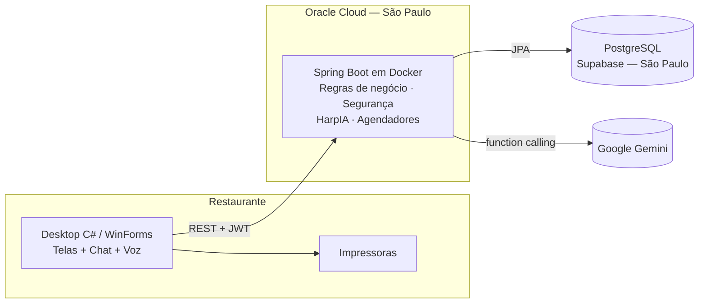
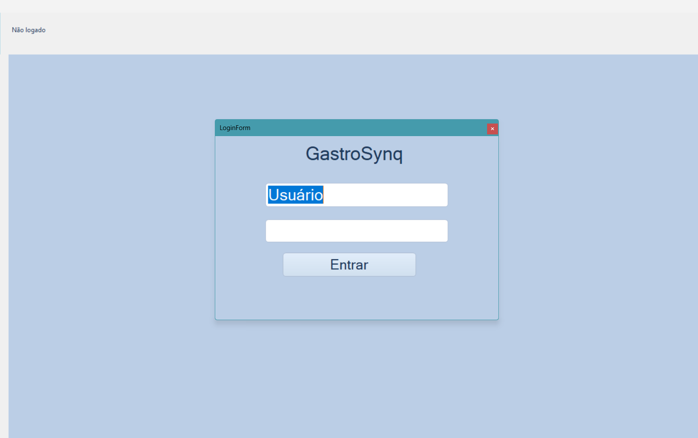
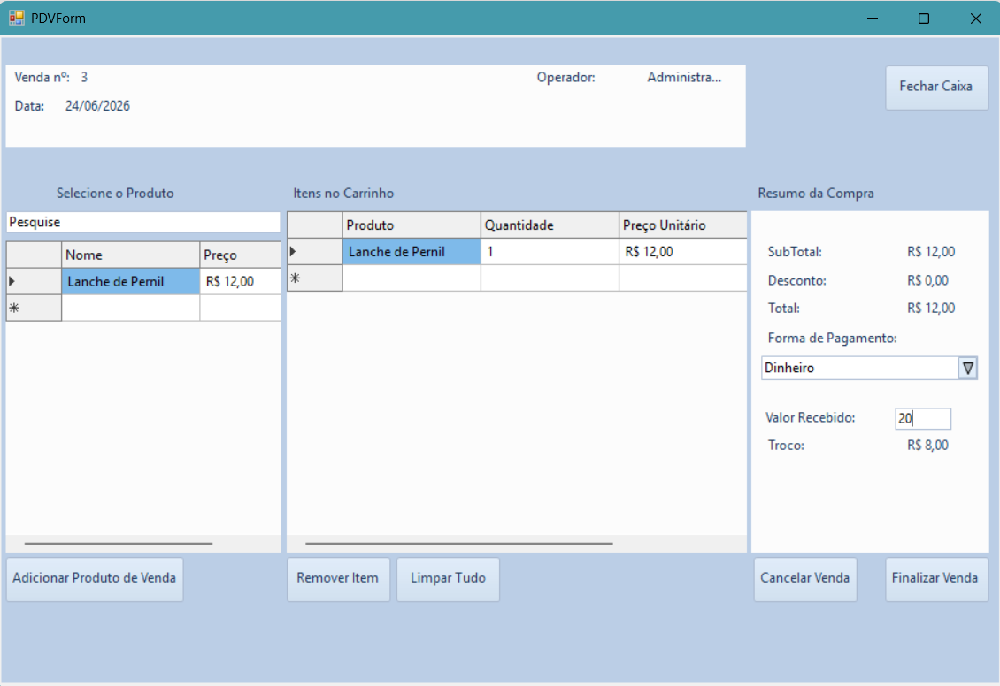
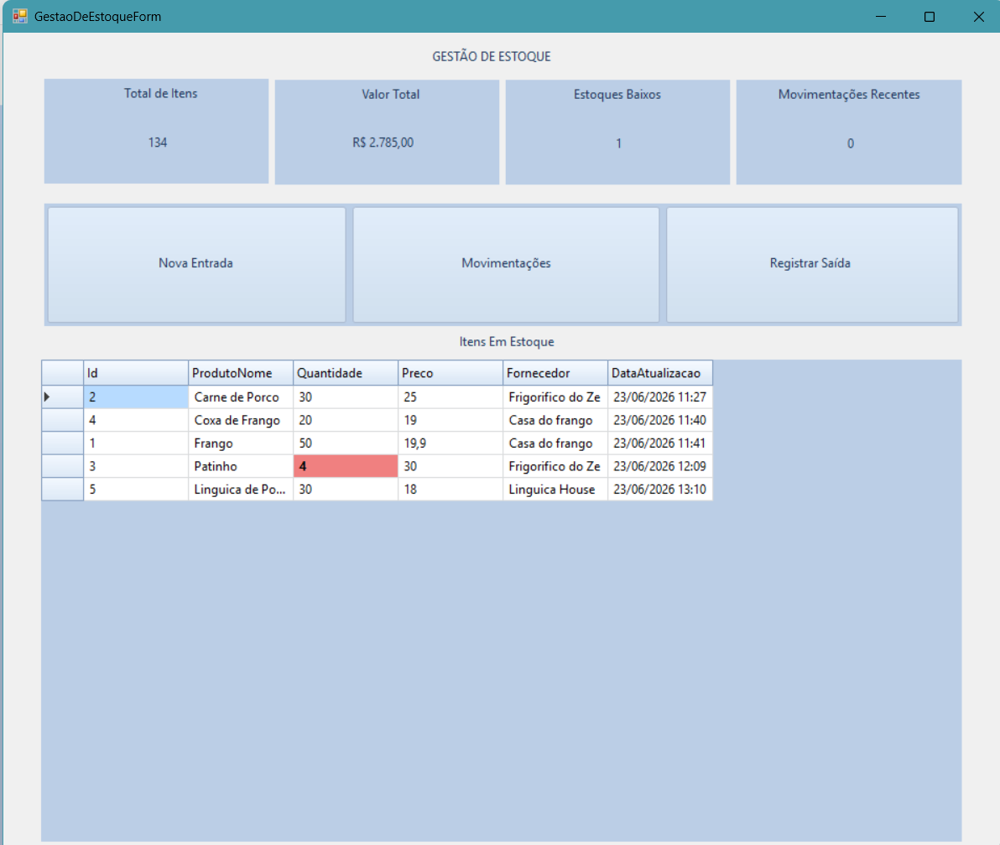
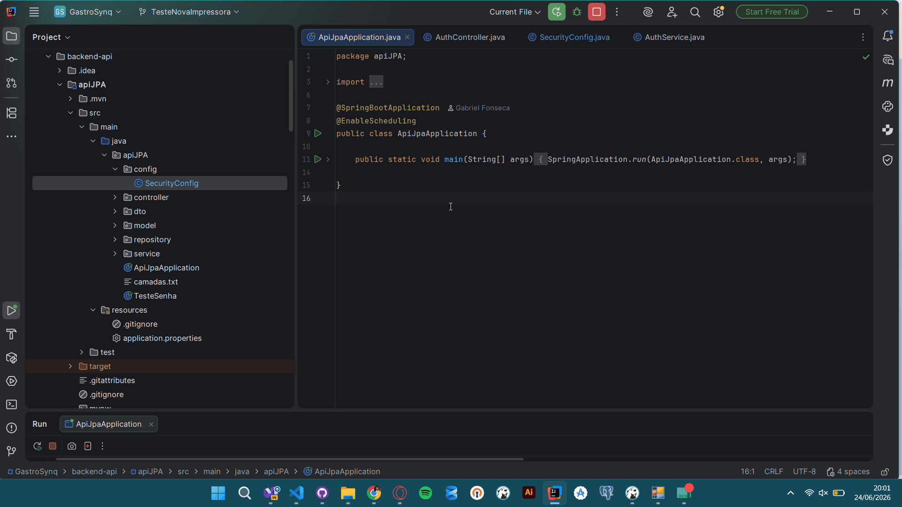
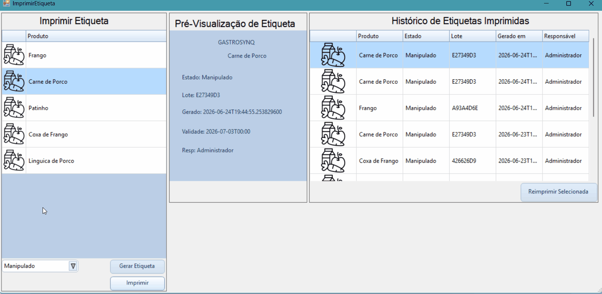

# GastroSynq

> Sistema de gestão para restaurantes com assistente de IA integrada. Controla estoque, cozinha, validade, vendas e caixa — e pode ser operado por texto ou por voz através da **HarpIA**, uma assistente que executa operações reais do sistema com confirmação por PIN.


---

# Visão Geral

O GastroSynq é um sistema de gestão (ERP) para restaurantes, desenvolvido para centralizar a operação diária e reduzir erros em vendas, estoque, validade de produtos e controle financeiro.

O sistema é composto por um cliente desktop em C#, uma API em Java Spring Boot rodando em Docker na Oracle Cloud, um banco PostgreSQL no Supabase e a **HarpIA**, assistente de IA construída sobre o Google Gemini.

A HarpIA permite que a equipe opere o sistema em linguagem natural:

> **"Vende 2 cocas e 1 misto quente no pix"**
> → a HarpIA identifica os itens, mostra o resumo (itens, total e pagamento), o funcionário confirma com o PIN e a venda é registrada pelas mesmas regras do PDV.

> **"O que está abaixo do mínimo?"** · **"Manda 2 kg de frango pra cozinha"** · **"Quais etiquetas vencem nos próximos 3 dias?"**

Tudo isso também **por voz**, a partir de uma bolinha flutuante disponível em qualquer tela.

---

# Problemas Resolvidos

Restaurantes frequentemente enfrentam:

* Controle manual de estoque e desperdício sem registro
* Produtos vencidos por falta de controle de validade
* Falta de rastreabilidade (quem fez, quando, com qual lote)
* Erros em vendas, troco e fechamento de caixa
* Falta de integração entre estoque, cozinha e caixa
* Equipe sem tempo para navegar em telas durante o movimento

O GastroSynq resolve esses problemas com uma plataforma única em que **toda movimentação tem responsável**, **todo produto tem validade controlada** e **qualquer operação pode ser pedida à IA**.

---

# Público-Alvo

* Restaurantes
* Lanchonetes
* Hamburguerias
* Pizzarias
* Operações de alimentação em geral

---

# Principais Funcionalidades

## 🤖 HarpIA — Assistente de IA

* Chat em linguagem natural com acesso a todos os módulos
* **Mais de 40 operações** (consultas e alterações) via function calling
* **Comando de voz** com resposta falada (botão Gravar e bolinha flutuante)
* **Nenhuma alteração sem confirmação**: pop-up com resumo + PIN do funcionário
* Permissão verificada pelo **cargo do dono do PIN**
* Venda de vários itens em um único pedido
* **Insights automáticos** de hora em hora sobre estoque, etiquetas e vendas
* Pesquisa de mercado (preços de insumos, tendências) via Google Search
* Histórico de conversas por dia

➡️ Detalhes em [docs/HARPIA.md](docs/HARPIA.md)

## Autenticação e Segurança

* Login com JWT
* Permissões por cargo (Funcionário, Gerente, Admin)
* PIN de 4 dígitos para confirmação de ações, com bloqueio após tentativas erradas
* Primeiro acesso guiado (criação do primeiro gerente)

## Gestão de Funcionários

* Cadastro, edição e desativação
* Regras de cargo (ninguém cria cargo acima do seu; sempre resta um gerente ativo)

## Cadastros

* Produtos (insumos), com fornecedor opcional
* Fornecedores
* Cardápio (itens de venda)

## Estoque

* Entrada com lote, validade e custo unitário
* Saída controlada: **somente para a cozinha ou como perda**
* Perdas consomem primeiro os lotes vencidos
* Estoque mínimo e alertas
* Histórico completo de movimentações com responsável

## Cozinha

* Estoque próprio da cozinha
* Registro de uso e de perda

## Etiquetas de Validade

* Validade calculada pela regra do estado do produto
* Impressão em impressoras Windows e Niimbot
* Reimpressão com data original e responsável
* Alerta de etiquetas vencendo ao abrir o sistema

## PDV e Caixa

* Carrinho com múltiplos itens
* Pagamento em dinheiro, Pix ou cartão
* Cálculo de troco (bloqueia venda em dinheiro com valor insuficiente)
* Abertura e fechamento de caixa com valor esperado na gaveta
* Fechamento automático de caixa esquecido aberto

## Relatórios e Dashboards

* Vendas por período e detalhamento
* Histórico de caixas
* Dashboards com indicadores e insights da IA

---

# Tecnologias Utilizadas

| Camada | Tecnologias |
| --- | --- |
| **Frontend Desktop** | C# 7.3, .NET Framework 4.8, WinForms, Krypton Toolkit, NAudio |
| **Backend** | Java 21, Spring Boot 3, Spring Security, JWT, Spring Data JPA, Hibernate, WebSocket |
| **Banco de Dados** | PostgreSQL (Supabase, região São Paulo) |
| **Inteligência Artificial** | Google Gemini (function calling, transcrição, TTS, Google Search, saída estruturada) |
| **Infraestrutura** | Docker, Oracle Cloud (Ubuntu 24.04), HikariCP |
| **Integrações** | Impressora Niimbot B1, impressoras Windows (incluindo térmicas) |
| **Ferramentas** | Git, GitHub, Visual Studio, IntelliJ |

---

# Arquitetura da Solução



**Princípio central:** a HarpIA não tem acesso direto ao banco. Ela escolhe operações que **já existem** na API, e essas operações passam pelas mesmas validações, transações e permissões usadas pelas telas.

➡️ Detalhes em [docs/ARCHITECTURE.md](docs/ARCHITECTURE.md)

---

# Fluxos Operacionais

## Venda

```text
Login → Abrir Caixa → Itens (tela ou HarpIA) → Pagamento e troco → Venda registrada → Fechamento → Relatórios
```

## Estoque

```text
Entrada (lote, validade, custo)
   → Estoque principal
        ├─→ Cozinha (com ou sem etiqueta) → Uso / Perda
        └─→ Perda
   → Histórico de movimentações
```

## Ação pela HarpIA

```text
Pedido (texto ou voz) → HarpIA monta a operação → Pop-up de confirmação
   → PIN + verificação de cargo → Execução pelas regras normais → Resultado
```

---

# Desempenho

O sistema roda em uma VM de **1 GB de RAM** e foi otimizado com base em medições reais de produção:

| Medição | Resultado |
| --- | --- |
| Consultas das telas | **15–190 ms** |
| Login + carregamento da tela principal | **< 1 s** |
| Pergunta à HarpIA com ferramenta | 5,5 s → **3,7 s** |
| Ciclo completo por voz | 17,3 s → **11,2 s** |

Principais otimizações: banco migrado para a mesma região do servidor, eliminação de consultas N+1, pool de conexões ajustado, cache de autenticação e redução de chamadas ao modelo de IA.

➡️ Detalhes em [docs/DESEMPENHO.md](docs/DESEMPENHO.md)

---

# Módulos Implementados

| Módulo | Status |
| --- | --- |
| Login e primeiro acesso | ✅ |
| Funcionários e cargos | ✅ |
| PIN de confirmação | ✅ |
| Produtos | ✅ |
| Fornecedores | ✅ |
| Cardápio | ✅ |
| Estoque e lotes | ✅ |
| Cozinha | ✅ |
| Validade e etiquetas | ✅ |
| Impressão (Niimbot e Windows) | ✅ |
| PDV e pagamentos | ✅ |
| Caixa (com fechamento automático) | ✅ |
| Relatórios e histórico | ✅ |
| Dashboards | ✅ |
| HarpIA — chat | ✅ |
| HarpIA — voz | ✅ |
| HarpIA — insights automáticos | ✅ |
| Implantação em nuvem (Docker + Oracle Cloud) | ✅ |

---

# Demonstração Visual

## Login



## PDV



## Gestão de Estoque



## Fluxos

| Fluxo | Demonstração |
| --- | --- |
| Login e autenticação |  |
| Gestão de estoque |  |
| Impressão de etiqueta |  |

Mais imagens em [`assets/screenshots`](assets/screenshots).

---

# Documentação

| Documento | Conteúdo |
| --- | --- |
| [DOCUMENTATION.md](docs/DOCUMENTATION.md) | Requisitos, casos de uso e regras de negócio |
| [ARCHITECTURE.md](docs/ARCHITECTURE.md) | Arquitetura, camadas, segurança e decisões |
| [DATABASE.md](docs/DATABASE.md) | Modelo de dados (28 tabelas) e fluxos transacionais |
| [HARPIA.md](docs/HARPIA.md) | Assistente de IA: ferramentas, voz, segurança e resiliência |
| [INFRAESTRUTURA.md](docs/INFRAESTRUTURA.md) | Servidor, Docker, deploy, banco e variáveis de ambiente |
| [DESEMPENHO.md](docs/DESEMPENHO.md) | Gargalos, otimizações e medições |
| [RECRUITER_SUMMARY.md](docs/RECRUITER_SUMMARY.md) | Resumo executivo |

---

# Principais Aprendizados

* Arquitetura cliente-servidor e APIs REST
* Segurança com JWT, controle por cargo e confirmação por PIN
* Modelagem relacional, ORM e controle transacional
* **IA aplicada com segurança**: function calling, confirmação humana e rastreabilidade
* Processamento de voz (transcrição e síntese)
* Resiliência a falhas de serviços externos (rotação de chaves, timeouts)
* Infraestrutura em nuvem com Docker em servidor de recursos limitados
* Otimização de desempenho guiada por medições
* Integração com hardware (impressoras e microfone)
* Desenvolvimento desktop

---

# Diferenciais Técnicos

* **IA que opera o sistema de verdade**, não apenas responde perguntas — sempre com confirmação humana e PIN
* A IA reutiliza as mesmas regras de negócio das telas, sem caminhos paralelos
* Comando de voz disponível em qualquer tela
* Rastreabilidade de ponta a ponta: cada movimentação, venda, etiqueta e ação da IA tem responsável
* Regra de estoque que impede saída sem justificativa (cozinha ou perda)
* Rodando em produção com custo de infraestrutura praticamente zero
* Desempenho medido e otimizado em ambiente real

---

# Roadmap

* HTTPS na API e backup automatizado
* Alertas proativos falados pela HarpIA
* Voz em streaming e pergunta por áudio em uma única etapa
* Histórico de conversa por funcionário
* Controle de compras e pedidos a fornecedores
* Aplicação Web e Mobile
* Integração fiscal
* Multiempresa e multiunidade

---

# Impacto do Projeto

O GastroSynq foi desenvolvido para resolver problemas reais de operações de alimentação, consolidando estoque, cozinha, validade, vendas e caixa em uma única plataforma — e tornando essa plataforma acessível por linguagem natural.

Além da implementação funcional, o projeto serviu como laboratório para a aplicação prática de arquitetura de software, segurança, banco de dados, infraestrutura em nuvem e inteligência artificial aplicada a um negócio real.

---

# Observação

Este repositório tem caráter demonstrativo e de portfólio.

Por conter regras de negócio e componentes utilizados em ambiente real, o código-fonte completo não é disponibilizado publicamente.

A documentação apresentada demonstra a arquitetura, as decisões técnicas, as tecnologias utilizadas e as competências aplicadas durante o desenvolvimento do sistema.