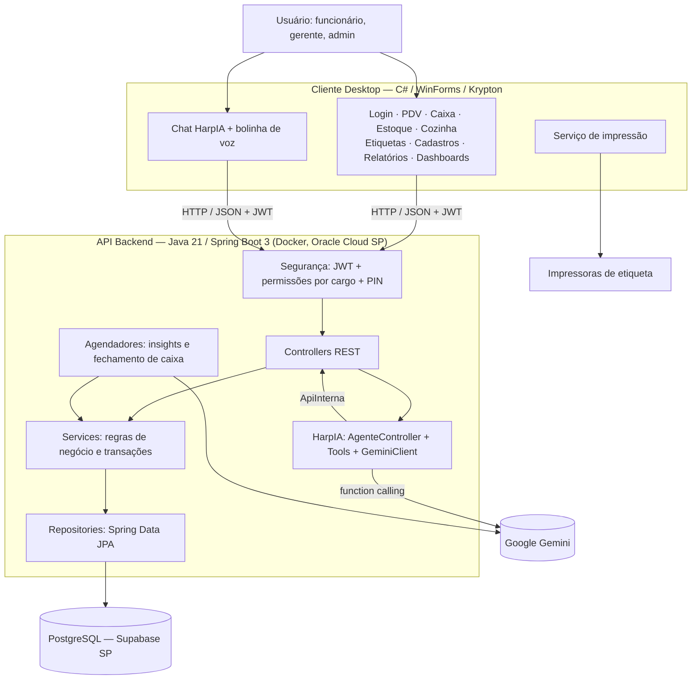

# ARCHITECTURE.md

# Arquitetura do Sistema — GastroSynq

## Visão Geral Arquitetural

O GastroSynq foi projetado com uma arquitetura cliente-servidor, separando interface de usuário, regras de negócio, persistência de dados e inteligência artificial.

A solução foi construída com foco em:

* Manutenibilidade
* Segurança e rastreabilidade
* Organização modular
* Desempenho em hardware modesto
* Reutilização de regras de negócio (telas e IA usam o mesmo backend)
* Facilidade de evolução

A aplicação é composta por quatro partes principais:

1. Cliente Desktop (WinForms)
2. API Backend (Spring Boot, em Docker na Oracle Cloud)
3. Banco de Dados PostgreSQL (Supabase)
4. Assistente de IA **HarpIA** (Google Gemini, integrada ao backend)

---

## Arquitetura Geral



---

# Arquitetura Cliente-Servidor

## Cliente

Responsável pela experiência do usuário.

Implementado em:

* C# 7.3 / .NET Framework 4.8
* Windows Forms
* Krypton Toolkit
* NAudio (gravação de voz)

Funções:

* Coleta de dados e validação básica
* Consumo da API REST
* Exibição de informações e dashboards
* Operações de PDV, caixa, estoque e cozinha
* Impressão de etiquetas
* Chat e comando de voz com a HarpIA

Toda regra crítica permanece no backend.

### Componentes de infraestrutura do cliente

| Componente | Responsabilidade |
| --- | --- |
| `ApiClient` | Requisições HTTP com token JWT, tratamento de erros (`ApiException`), envio de arquivos (áudio) e recebimento de bytes (voz) |
| `SessionManager` | Usuário logado e token |
| `ErroHelper` | Converte erros técnicos em mensagens claras para o usuário |
| Indicador de carregamento | Aparece no topo quando uma requisição passa de 300 ms |
| `PrinterService` | Impressão em impressoras Windows e Niimbot |

---

## Servidor

Responsável pela lógica de negócio e pela IA.

Implementado em:

* Java 21
* Spring Boot 3.3
* Spring Security + JWT
* Spring Data JPA / Hibernate
* WebSocket (notificações de insights)

Funções:

* Autenticação e autorização por cargo
* Processamento de vendas e controle de caixa
* Controle de estoque, lotes, validade e cozinha
* Etiquetas de validade
* Relatórios
* Assistente HarpIA (texto e voz)
* Tarefas agendadas (insights e fechamento automático de caixa)

---

## Banco de Dados

Responsável pelo armazenamento centralizado.

Tecnologias:

* PostgreSQL gerenciado pelo Supabase
* Região São Paulo (mesma do servidor)
* Conexão via session pooler com pool fixo de 4 conexões

Funções:

* Persistência de dados
* Integridade relacional
* Histórico operacional e de conversas da IA
* Consistência transacional

Detalhes em [DATABASE.md](DATABASE.md) e [INFRAESTRUTURA.md](INFRAESTRUTURA.md).

---

# Separação de Responsabilidades

## Frontend

Responsável por:

* Interface gráfica e navegação
* Consumo de APIs
* Feedback ao usuário
* Gravação e reprodução de áudio
* Impressão

Não possui responsabilidade sobre:

* Segurança
* Persistência
* Regras críticas

---

## Backend

Responsável por:

* Regras de negócio
* Segurança e permissões
* Controle transacional
* Persistência
* Orquestração da IA

Não possui responsabilidade sobre:

* Interface visual

---

## IA (HarpIA)

Responsável por:

* Interpretar pedidos em linguagem natural
* Escolher qual operação do sistema executar
* Explicar resultados em linguagem natural

Não possui responsabilidade sobre:

* Regras de negócio — executa as mesmas operações das telas, pelas mesmas validações
* Decidir sozinha — toda alteração exige confirmação humana com PIN

---

## Banco

Responsável por:

* Armazenamento
* Relacionamentos
* Integridade dos dados

---

# Camadas da Aplicação

## Controller Layer

Recebe requisições HTTP.

Responsabilidades:

* Receber e validar dados de entrada
* Encaminhar para Services
* Retornar respostas padronizadas

Principais controllers:

| Controller | Domínio |
| --- | --- |
| `AuthController` | Login |
| `SetupController` | Primeiro acesso (criação do primeiro gerente) |
| `FuncionarioController` | Funcionários |
| `ProdutoController` | Produtos de estoque |
| `FornecedorController` | Fornecedores |
| `EstoqueController` | Estoque, entradas, perdas, envio para a cozinha, movimentações |
| `CozinhaController` | Estoque da cozinha, uso e perda |
| `EtiquetaController` | Geração, impressão e vencimento de etiquetas |
| `VendaController` / `CaixaController` | PDV, pagamentos e caixa |
| `AgenteController` | HarpIA (perguntar, confirmar, transcrever, falar) |
| Chat e Insights | Histórico de conversa e análises automáticas |

---

## Service Layer

Camada principal de negócio.

Responsabilidades:

* Processamento das regras
* Validações
* Transações (`@Transactional`)
* Orquestração entre domínios

Exemplos:

* `VendaService` — venda transacional com validações
* `CaixaService` — abertura, fechamento e valor esperado em gaveta
* `EstoqueService` — entrada com lote, validade e custo; perda; transferência para a cozinha
* `EtiquetaService` — valida a regra de validade antes de mexer no estoque
* `FuncionarioService` — cadastro com regras de cargo
* `PinService` — validação do PIN com bloqueio por tentativas
* `InsightService` — análises automáticas com IA

---

## Repository Layer

Responsável pelo acesso aos dados.

Tecnologias:

* Spring Data JPA
* Hibernate (com busca em lote para evitar consultas N+1)

Responsabilidades:

* CRUD
* Consultas
* Filtros

---

## Database Layer

Responsável pela persistência.

Tecnologias:

* PostgreSQL

---

# Fluxo de Dados

## Exemplo: Realização de Venda pelo PDV

```text
Operador → PDV Desktop
   → POST /vendas (JWT)
   → JwtFiltro: token válido + funcionário ativo + cargo permitido
   → VendaController → VendaService (@Transactional)
        • valida os produtos do cardápio (ativos)
        • valida o caixa aberto
        • cria a venda, os itens e o pagamento
   → PostgreSQL
   → resposta para o Desktop
```

Se qualquer etapa falhar, a transação inteira é desfeita.

## Exemplo: Mesma Venda pela HarpIA

```text
"Vende 2 cocas e 1 misto quente no pix"
   → POST /agente/perguntar
   → Gemini escolhe registrar_venda(itens, pagamento)
   → VendaTools monta o resumo (itens, total, pagamento)
   → pop-up de confirmação no Desktop → PIN do funcionário
   → POST /agente/confirmar
        • PIN identifica quem confirmou e o cargo
        • ApiInterna chama o MESMO endpoint de venda do PDV
   → mesmo VendaService, mesmas validações, mesma transação
```

A IA não tem um caminho próprio para gravar dados: ela usa exatamente as operações das telas. Isso garante que nenhuma regra de negócio seja burlada. Detalhes em [HARPIA.md](HARPIA.md).

## Exemplo: Produto saindo do estoque

Regra do restaurante: um produto só sai do estoque principal de duas formas.

```text
Estoque principal
   ├── para a COZINHA (com etiqueta de validade, ou sem etiqueta para itens prontos)
   │      → MovimentacaoEstoque (MANIPULACAO) + MovimentacaoCozinha (ENTRADA)
   └── como PERDA (vencido, estragado, descarte)
          → consome primeiro os lotes vencidos
```

Na cozinha, o produto sai por **uso** ou por **perda**.

---

# Fluxo de Autenticação

```text
Primeira execução sem usuários
   → GET /setup/status → tela de configuração inicial
   → POST /setup/inicial → cria o primeiro GERENTE

Login
   → POST /auth/login
   → AuthService: senha BCrypt + funcionário ativo
   → geração do JWT
   → token guardado na sessão do Desktop
   → enviado em todas as requisições
```

---

# Arquitetura de Segurança

## Autenticação

* JWT assinado com segredo vindo de variável de ambiente (`JWT_SECRET`).
* A cada requisição, o `JwtFiltro` valida o token **e** confirma que o funcionário continua ativo (com cache de 30 s, limpo imediatamente quando o funcionário é editado ou desativado).
* Funcionário desativado não consegue fazer login.

## Senhas e PIN

* Senhas com **BCrypt** (hash irreversível com salt).
* Cada funcionário tem um **PIN de 4 dígitos**, também com hash e único no sistema.
* 5 PINs errados bloqueiam novas tentativas por 2 minutos.

## Controle de Acesso por Cargo

| Cargo | Acesso |
| --- | --- |
| **Funcionário** | PDV, caixa, etiquetas, cozinha, HarpIA e consultas |
| **Gerente** | Tudo do funcionário + estoque, cadastros, estoque mínimo, PINs e exclusões |
| **Admin** | Tudo |

Regras adicionais:

* Ninguém cria um funcionário com cargo acima do seu.
* Ninguém desativa a si mesmo.
* Sempre resta pelo menos um gerente ativo.
* Exclusões são **lógicas** (o registro é desativado, preservando o histórico).

## Rastreabilidade das ações da IA

O computador pode ficar logado o dia todo; quem confirma cada ação da HarpIA é identificado pelo **PIN** digitado no pop-up, e o **cargo do dono do PIN** decide se a ação é permitida.

## Segredos

* Credenciais do banco, chaves do Gemini e segredo JWT ficam no `.env` do servidor, fora do código e do Git.

---

# Integração com Impressão de Etiquetas

```text
Backend: EtiquetaService
   → valida a regra de validade do produto
   → registra a etiqueta (data de geração, validade, responsável)
   → devolve os dados da etiqueta

Desktop: PrinterService
   ├── Impressoras Windows (ex.: térmica POS58 — desenho direto em texto)
   └── Niimbot B1 (imagem da etiqueta)
```

* A impressora é configurada e salva em cada computador.
* Reimpressões mostram a data de geração original e o responsável ("Resp:").
* Etiquetas próximas do vencimento geram alerta ao abrir o sistema (`GET /etiqueta/vencendo?dias=N`).

Objetivo:

* Separar lógica de negócio da lógica de impressão.
* Permitir troca de fabricante.

---

# Tarefas Agendadas

| Tarefa | Quando | O que faz |
| --- | --- | --- |
| Insights | De hora em hora, 9h–23h | A HarpIA analisa estoque, etiquetas e vendas e gera comentários por módulo |
| Fechamento de caixa | 05:00 | Fecha automaticamente um caixa esquecido aberto |

Ambas rodam no fuso de São Paulo e podem ser reconfiguradas por variável de ambiente.

---

# Decisões Arquiteturais

## WinForms ao invés de Web

Motivação:

* Operação local em computadores do restaurante
* Acesso direto a impressoras e microfone
* Facilidade de implantação
* Ambiente controlado

Trade-off:

* Dependência de Windows

---

## Spring Boot

Motivação:

* Produtividade
* Ecossistema robusto
* Segurança integrada
* Grande adoção corporativa

---

## PostgreSQL (Supabase)

Motivação:

* Banco relacional robusto
* Integridade transacional
* Serviço gerenciado (backup e manutenção pelo provedor)

---

## JWT

Motivação:

* Autenticação desacoplada
* Sessões sem estado no servidor

---

## Google Gemini com Function Calling

Motivação:

* A IA escolhe **operações existentes** em vez de gerar SQL ou acessar o banco diretamente
* Suporte nativo a áudio (transcrição) e voz (TTS) no mesmo provedor
* Modelo flash-lite com bom custo-benefício
* Rotação de até 30 chaves para resiliência a limites de cota

---

## Docker na Oracle Cloud

Motivação:

* Ambiente reproduzível
* Reinício automático
* Deploy com um único script
* Camada gratuita da Oracle Cloud

---

# Benefícios da Arquitetura

* Separação clara de responsabilidades
* Regras de negócio centralizadas, reaproveitadas pelas telas e pela IA
* Segurança e rastreabilidade em todas as operações
* Facilidade de manutenção e evolução modular
* Baixo custo de operação

---

# Trade-offs Assumidos

| Decisão | Benefício | Trade-off |
| --- | --- | --- |
| WinForms | Rapidez de desenvolvimento, acesso a hardware | Dependência de Windows |
| Monólito Spring Boot | Simplicidade operacional | Escalabilidade limitada em módulos específicos |
| PostgreSQL único | Consistência transacional | Possível gargalo futuro |
| JWT | Simplicidade e desacoplamento | Necessidade de gestão de expiração |
| IA em nuvem (Gemini) | Qualidade e voz sem infraestrutura própria | Depende de internet e de cota da API |
| VM de 1 GB | Custo zero | Exige configuração cuidadosa de memória |

---

# Possíveis Evoluções

## Curto Prazo

* HTTPS na API
* Backup automatizado do banco
* Refresh tokens
* Logs centralizados

---

## Médio Prazo

* Alertas proativos falados pela HarpIA
* Histórico de conversa por funcionário
* Relatórios analíticos avançados

---

## Longo Prazo

* Aplicação Web
* Aplicativo Mobile
* Integração fiscal
* Integração com marketplaces
* Multiempresa e multiunidade

---

# Considerações Arquiteturais Finais

O GastroSynq foi concebido seguindo princípios de engenharia de software utilizados em aplicações corporativas:

* Arquitetura em camadas
* Separação de responsabilidades
* Controle centralizado de regras de negócio
* Segurança baseada em JWT, cargos e PIN
* Persistência relacional robusta
* IA integrada de forma segura, sem acesso direto aos dados

Mesmo desenvolvido em contexto acadêmico, sua estrutura reflete práticas de sistemas empresariais reais, demonstrando domínio de backend, banco de dados, segurança, integração, infraestrutura em nuvem e inteligência artificial aplicada.