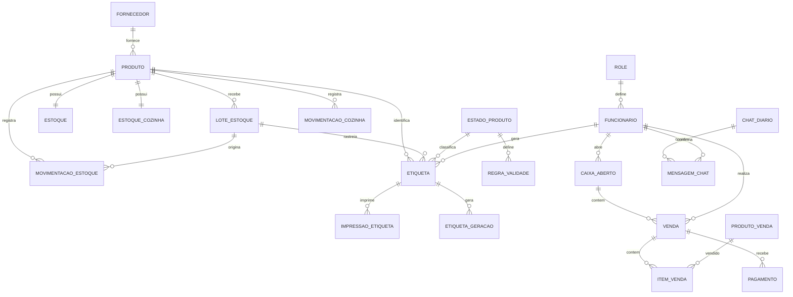

# DATABASE.md

# Banco de Dados — GastroSynq

## Visão Geral

O GastroSynq utiliza **PostgreSQL**, gerenciado pelo **Supabase** na região de São Paulo (a mesma do servidor da aplicação).

O modelo foi projetado para atender operações de restaurantes que exigem:

* Controle de estoque principal e da cozinha
* Controle de lotes, validade e custo de entrada
* Etiquetas de validade com rastreabilidade
* Operação de PDV e controle de caixa
* Gestão de funcionários com cargos e PIN
* Histórico de conversas e análises da IA (HarpIA)
* Histórico operacional completo

A modelagem busca garantir integridade referencial, rastreabilidade e consistência transacional.

O esquema é criado e atualizado pelo Hibernate (`ddl-auto=update`) a partir das entidades JPA. A versão atual tem **28 tabelas**.

---

# Estratégia de Modelagem

O banco é dividido em domínios funcionais:

| Domínio | Tabelas |
| --- | --- |
| Segurança e usuários | `role`, `funcionario` |
| Cadastro | `produto`, `fornecedor`, `tag`, `produto_venda` |
| Estoque principal | `estoque`, `lote_estoque`, `movimentacao_estoque` |
| Cozinha | `estoque_cozinha`, `movimentacao_cozinha` |
| Qualidade e rastreabilidade | `estado_produto`, `regra_validade`, `produto_estado_historico`, `etiqueta`, `etiqueta_geracao`, `impressao_etiqueta`, `log_rastreabilidade` |
| Vendas | `venda`, `item_venda`, `pagamento` |
| Financeiro | `caixa_aberto` |
| Inteligência artificial | `chat_diario`, `mensagem_chat`, `insight` |
| Reservado para evolução | `cliente`, `pedido`, `item_pedido` |

---

# Diagrama de Relacionamentos (principal)

O diagrama completo está em `assets/diagrams/erd_completo.png`.

---

# Domínio de Segurança

## role

Define os cargos do sistema.

| Campo | Descrição |
| --- | --- |
| `id` | Identificador |
| `nome` | Nome do cargo (Funcionário, Gerente, Admin) |
| `nivel_permissao` | Nível numérico usado para comparar cargos |

O nível permite regras como "ninguém cria um funcionário com cargo acima do seu".

---

## funcionario

Usuários autenticáveis.

| Campo | Descrição |
| --- | --- |
| `id` | Identificador |
| `nome`, `email`, `cpf` | Dados cadastrais |
| `senha` | Hash BCrypt |
| `pin` | Hash do PIN de 4 dígitos, único no sistema, usado para confirmar ações da HarpIA |
| `ativo` | Exclusão lógica: funcionário desativado não faz login, mas o histórico é preservado |
| `data_admissao` | Data de admissão |
| `role_id` | Cargo |

### Relacionamentos

* N:1 `role`
* 1:N `venda`, `caixa_aberto`, `etiqueta`, `movimentacao_estoque`, `movimentacao_cozinha`, `mensagem_chat`

---

# Domínio de Cadastro

## produto

Insumos e itens controlados no estoque.

| Campo | Descrição |
| --- | --- |
| `id`, `nome`, `descricao` | Identificação |
| `unidade_medida` | kg, un, L... |
| `preco` | Preço de compra atual (atualizado pela última entrada com preço) |
| `perecivel` | Se o produto vence |
| `controla_lote` | Se as entradas são controladas por lote |
| `validade_padrao` | Validade sugerida na entrada |
| `ativo` | Exclusão lógica |
| `fornecedor_id` | Fornecedor (opcional) |

Ao cadastrar um produto, os registros de `estoque` e `estoque_cozinha` são criados zerados.

---

## fornecedor

| Campo | Descrição |
| --- | --- |
| `id`, `nome`, `email`, `observacao` | Dados cadastrais |
| `cnpj`, `telefone` | Gravados apenas com dígitos (formatação fica na tela) |

---

## produto_venda

Cardápio do PDV — o que o cliente compra (ex.: "Coca lata 350ml", "Misto quente").

| Campo | Descrição |
| --- | --- |
| `id`, `nome` | Identificação |
| `preco` | Preço de venda |
| `ativo` | Só itens ativos podem ser vendidos |

O cardápio é separado do cadastro de insumos (`produto`): um item de cardápio pode usar vários insumos, e um insumo pode compor vários itens.

---

## tag

Marcadores livres associados a produtos.

---

# Domínio de Estoque Principal

## estoque

Saldo atual de cada produto no estoque principal.

| Campo | Descrição |
| --- | --- |
| `produto_id` | Produto |
| `quantidade` | Saldo atual |
| `estoque_minimo` | Abaixo disso, o produto aparece nos alertas e na HarpIA |
| `data_atualizacao` | Última alteração |

---

## lote_estoque

Cada entrada de mercadoria gera um lote.

| Campo | Descrição |
| --- | --- |
| `id_lote` | Código do lote |
| `data_entrada` | Data da entrada |
| `data_validade` | Validade (editável na entrada; não aceita data passada) |
| `qtd_atual` | Quanto ainda resta do lote |
| `custo_unitario` | Preço pago por unidade nessa entrada (opcional) |
| `produto_id` | Produto |

O custo por lote permite calcular o valor do estoque e comparar preços ao longo do tempo.

---

## movimentacao_estoque

Histórico de tudo que entra e sai do estoque principal.

| Campo | Descrição |
| --- | --- |
| `tipo_movimentacao` | `ENTRADA`, `MANIPULACAO` (envio para a cozinha), `PERDA`, `AJUSTE` |
| `qtd` | Quantidade |
| `observacao` | Motivo / detalhe |
| `data_movimentacao` | Data e hora |
| `produto_id`, `lote_id` | Produto e lote afetados |
| `funcionario_id` | Quem fez a movimentação |

### Regra de saída

Um produto só sai do estoque principal de duas formas:

* **Para a cozinha** (`MANIPULACAO`) — com etiqueta de validade, ou sem etiqueta para itens prontos como bebidas em lata.
* **Como perda** (`PERDA`) — consome primeiro os lotes vencidos.

---

# Domínio da Cozinha

## estoque_cozinha

Saldo de cada produto que já foi enviado para a cozinha.

| Campo | Descrição |
| --- | --- |
| `produto_id`, `quantidade` | Produto e saldo |
| `estoque_minimo` | Mínimo da cozinha |
| `data_atualizacao` | Última alteração |

## movimentacao_cozinha

| Campo | Descrição |
| --- | --- |
| `tipo_movimentacao` | `ENTRADA` (vinda do estoque), `SAIDA` (uso), `PERDA` |
| `quantidade`, `observacao`, `data_movimentacao` | Detalhes |
| `produto_id`, `funcionario_id` | Produto e responsável |

A transferência para a cozinha grava, na **mesma transação**, a saída em `movimentacao_estoque` e a entrada em `movimentacao_cozinha`.

---

# Domínio de Qualidade e Rastreabilidade

## estado_produto

Estados de manipulação do produto (ex.: resfriado, congelado, aberto, manipulado), que definem a validade.

## regra_validade

| Campo | Descrição |
| --- | --- |
| `estado_produto_id` | Estado |
| `dias_validade` | Quantos dias o produto dura nesse estado |
| `ativo` | Regra em uso |

## produto_estado_historico

Histórico de mudanças de estado de cada produto (`data_inicio`, `data_fim`, `origem`, responsável).

## etiqueta

Etiqueta de validade gerada para um produto manipulado.

| Campo | Descrição |
| --- | --- |
| `produto_id`, `lote_estoque_id` | O que foi etiquetado e de qual lote veio |
| `estado_produto_id` | Estado que determinou a validade |
| `quantidade` | Quantidade etiquetada |
| `lote` | Código do lote impresso |
| `data_geracao` | Quando foi gerada (mantida em reimpressões) |
| `validade_calculada` | Validade a partir da regra do estado |
| `funcionario_id` | Responsável (impresso como "Resp:") |
| `produto_estado_historico_id` | Registro de estado correspondente |

A geração da etiqueta valida a regra de validade **antes** de movimentar o estoque, em uma única transação.

## etiqueta_geracao

Registro técnico de cada geração (payload enviado e status).

## impressao_etiqueta

Controle de impressão: `status`, `tentativas`, `log_erro`, `quantidade`, `data_envio`.

## log_rastreabilidade

Auditoria de ações sobre produtos e etiquetas: `acao`, `descricao`, `data`, produto, etiqueta e funcionário.

---

# Domínio de Vendas

## venda

| Campo | Descrição |
| --- | --- |
| `data_venda` | Data e hora |
| `valor_total` | Total da venda |
| `funcionario_id` | Quem vendeu (pelo PDV, a sessão; pela HarpIA, o dono do PIN) |
| `caixa_id` | Caixa em que a venda entrou |

## item_venda

| Campo | Descrição |
| --- | --- |
| `venda_id` | Venda |
| `produto_venda_id` | Item do cardápio |
| `quantidade`, `preco_unitario`, `subtotal` | Valores congelados no momento da venda |

O preço é copiado para o item: mudar o preço do cardápio depois não altera vendas antigas.

## pagamento

| Campo | Descrição |
| --- | --- |
| `venda_id` | Venda |
| `metodo_pagamento` | Dinheiro, Pix ou cartão |
| `valor`, `data_pagamento`, `status` | Detalhes |
| `transacao_id`, `nota_fiscal` | Reservados para integração com meios de pagamento e emissão fiscal |
| `funcionario_id` | Responsável |

---

# Domínio Financeiro

## caixa_aberto

| Campo | Descrição |
| --- | --- |
| `funcionario_id` | Quem abriu |
| `data_abertura`, `data_fechamento` | Período do caixa |
| `aberto` | Se ainda está aberto |
| `valor_inicial` | Troco na abertura |
| `valor_esperado` | Quanto deveria haver na gaveta: valor inicial + vendas em **dinheiro** (Pix e cartão são contabilizados à parte) |
| `valor_final` | Valor contado no fechamento (fica vazio quando o caixa é fechado automaticamente) |

Um caixa esquecido aberto é fechado automaticamente às 05:00.

---

# Domínio de Inteligência Artificial

## chat_diario

Uma conversa por dia (`data` com restrição de unicidade).

## mensagem_chat

| Campo | Descrição |
| --- | --- |
| `chat_diario_id` | Dia da conversa |
| `remetente` | `FUNCIONARIO` ou `IA` |
| `tipo` | `TEXTO` ou `AUDIO` |
| `conteudo` | Texto da mensagem |
| `enviado_em` | Data e hora |
| `funcionario_id` | Preenchido nas confirmações, com o dono do PIN |

## insight

Análises automáticas geradas pela HarpIA.

| Campo | Descrição |
| --- | --- |
| `modulo` | `estoque`, `etiquetas` ou `pdv` |
| `nivel` | Nível de alerta |
| `comentario` | Texto da análise |
| `data_criacao` | Quando foi gerado |

---

# Tabelas Reservadas

`cliente`, `pedido` e `item_pedido` foram modeladas para uma futura funcionalidade de pedidos/delivery com cadastro de clientes e **não são usadas** pela versão atual.

---

# Fluxos Transacionais

## Venda

1. Caixa aberto verificado
2. Itens validados no cardápio (apenas ativos)
3. Venda criada
4. Itens registrados com preço congelado
5. Pagamento registrado
6. Valor esperado do caixa atualizado (vendas em dinheiro)

Tudo em uma transação: se uma etapa falha, nada é gravado.

## Entrada de Estoque

1. Lote criado (validade, quantidade, custo unitário)
2. Saldo do estoque atualizado
3. Preço atual do produto atualizado (se informado)
4. Movimentação `ENTRADA` registrada com o funcionário

## Envio para a Cozinha

1. Saldo do estoque principal verificado
2. Lotes consumidos
3. Movimentação `MANIPULACAO` no estoque
4. Saldo da cozinha atualizado
5. Movimentação `ENTRADA` na cozinha

## Etiqueta

1. Regra de validade do estado verificada
2. Validade calculada
3. Produto transferido para a cozinha (mesma transação)
4. Etiqueta registrada com responsável
5. Impressão registrada

---

# Estratégias de Integridade

* Chaves primárias em todas as entidades
* Chaves estrangeiras nos relacionamentos
* Unicidade em CPF, e-mail e data do chat diário; PIN único garantido pela aplicação
* Transações com `@Transactional` nas operações que alteram mais de uma tabela
* **Exclusão lógica** (`ativo`) em funcionários, produtos e cardápio, preservando o histórico
* Valores de venda congelados nos itens
* Funcionário responsável registrado em todas as movimentações

---

# Desempenho

* **Mesma região** do servidor (São Paulo): consultas em poucos milissegundos de rede.
* **Pool fixo de 4 conexões** (HikariCP) dentro do limite de 15 do session pooler.
* **`default_batch_fetch_size=50`**: relacionamentos carregados em lote, evitando consultas N+1.

Detalhes em [DESEMPENHO.md](DESEMPENHO.md).

---

# Estratégias de Indexação

Índices recomendados para crescimento do volume:

* `funcionario(email)`, `funcionario(cpf)`
* `produto(nome)`
* `lote_estoque(produto_id, data_validade)`
* `venda(data_venda)`
* `pagamento(data_pagamento)`
* `caixa_aberto(aberto)`
* `movimentacao_estoque(data_movimentacao)`
* `mensagem_chat(chat_diario_id, enviado_em)`
* `insight(modulo, data_criacao)`

---

# Débitos Técnicos Conhecidos

Como o esquema evolui por `ddl-auto=update`, colunas renomeadas no código permanecem no banco:

* `venda.caixa_abeto_id` — coluna antiga, substituída por `caixa_id`
* `pagamento.metodo` — coluna antiga, substituída por `metodo_pagamento`

Para uma versão de produção, a recomendação é adotar migrações versionadas (Flyway ou Liquibase) e remover essas colunas.

---

# Estratégias de Escalabilidade

Possíveis evoluções futuras:

* Migrações versionadas (Flyway)
* Particionamento de vendas e logs por período
* Read replicas PostgreSQL
* Backup automatizado adicional (`pg_dump` agendado)
* Separação por unidade (multi-restaurante)

---

# Considerações Finais

O modelo foi desenvolvido para cenários reais de operação gastronômica, priorizando integridade, rastreabilidade e auditabilidade. Toda movimentação de estoque, venda, etiqueta e ação da IA registra **quem** fez e **quando**, permitindo reconstruir a história de cada produto — da entrada no estoque até a cozinha ou o descarte.