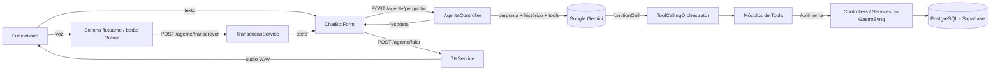

# HARPIA.md

# HarpIA — Assistente de IA do GastroSynq

## Visão Geral

A **HarpIA** é a assistente de inteligência artificial do GastroSynq e o principal diferencial do projeto.

Ela funciona como um **gerente virtual do restaurante**: conhece todos os módulos do sistema (estoque, cozinha, etiquetas, produtos, cardápio, fornecedores, vendas, caixa e insights) e permite que o funcionário consulte informações e execute operações **em linguagem natural, por texto ou por voz**.

Exemplos reais de uso:

* "O que tem no estoque?"
* "Quais produtos estão abaixo do mínimo?"
* "Manda 2 kg de frango pra cozinha"
* "Vende 2 cocas e 1 misto quente no pix"
* "Quais etiquetas vencem nos próximos 3 dias?"
* "Quanto vendemos hoje?"
* "Qual o preço médio do quilo do frango no atacado?"

A HarpIA é construída sobre o **Google Gemini** usando **function calling** (chamada de ferramentas): o modelo não acessa o banco diretamente — ele decide **qual função do sistema chamar** e com quais parâmetros, e o backend executa essa função pelas mesmas regras de negócio usadas pelas telas.

---

# Princípios de Projeto

| Princípio | Como foi aplicado |
| --- | --- |
| **Nunca agir sem confirmação** | Toda alteração (venda, entrada, cadastro, remoção, abrir/fechar caixa) gera um pop-up de confirmação com PIN antes de ser executada |
| **Mesmas regras das telas** | As ferramentas chamam a API interna do próprio backend — a IA não tem atalho para burlar validações |
| **Rastreabilidade** | Quem confirma a ação é identificado pelo PIN, não pela sessão aberta no computador |
| **Permissão por cargo** | O cargo do dono do PIN decide se a ação pode ser executada |
| **Nunca inventar dados** | Se faltar informação (produto, quantidade, forma de pagamento), a HarpIA pergunta antes de agir |
| **Velocidade** | Atalhos evitam chamadas desnecessárias ao modelo (ver seção Desempenho) |

---

# Arquitetura



## Componentes principais

| Componente | Responsabilidade |
| --- | --- |
| `AgenteController` | Endpoints `/agente/*`, monta a conversa, decide entre responder, pedir confirmação ou humanizar |
| `GeminiClient` | Chamada HTTP ao Gemini com timeout, rotação de chaves e tratamento de erros |
| `GeminiConfig` | Lê as chaves `GEMINI_KEY_1..30` e os modelos configuráveis por variável de ambiente |
| `HarpiaIdentity` | Instrução de sistema (persona, regras de decisão, regras do restaurante, tom) |
| `ToolCallingOrchestrator` | Roteia cada função pedida pelo modelo para o módulo de tools correto |
| `*Tools` (10 módulos) | Declaração e execução das funções de cada domínio |
| `ApiInterna` | Chamada HTTP interna aos endpoints do próprio backend, com timeout e mensagem de erro real |
| `BuscaPorNome` | Busca tolerante de produtos/fornecedores por nome |
| `FormatadorConsulta` | Formata listas diretamente, sem segunda chamada ao modelo |
| `TranscricaoServiceImpl` | Converte o áudio gravado em texto (Gemini com áudio inline) |
| `TtsServiceImpl` | Converte a resposta em fala (Gemini TTS) |
| `InsightService` | Gera análises automáticas do negócio de hora em hora |
| `PinService` | Valida o PIN de 4 dígitos de quem confirma a ação |

---

# Endpoints

| Método | Rota | Função |
| --- | --- | --- |
| `POST` | `/agente/perguntar` | Envia a pergunta do usuário e recebe a resposta (ou um pedido de confirmação) |
| `POST` | `/agente/confirmar` | Executa a ação pendente depois que o usuário confirma no pop-up com PIN |
| `POST` | `/agente/transcrever` | Recebe um arquivo WAV e devolve o texto transcrito |
| `POST` | `/agente/falar` | Recebe um texto e devolve o áudio WAV da resposta |
| `GET` | `/chat/dias` | Lista os dias que têm conversa salva |
| `GET` | `/chat/historico/{data}` | Histórico da conversa de um dia |
| `GET` | `/insights/atual` | Último insight gerado por módulo |
| `GET` | `/insights/historico` | Histórico de insights |

Todas as rotas exigem token JWT.

---

# Fluxo de uma Pergunta

## 1. Consulta (não altera dados)

```text
Usuário: "Quais produtos estão abaixo do mínimo?"
        │
        ▼
AgenteController monta a requisição:
  • instrução de sistema (HarpiaIdentity)
  • histórico do chat do dia (últimos 10 turnos)
  • pista da tela atual ("[Usuário está na tela: Estoque]")
  • declaração de todas as ferramentas
        │
        ▼
Gemini responde com: functionCall listar_estoque_abaixo_minimo()
        │
        ▼
ToolCallingOrchestrator → EstoqueTools → ApiInterna → GET /estoque/...
        │
        ▼
Resultado volta para o Gemini, que escreve a resposta em linguagem natural
(ou, se foi só um pedido de lista, o FormatadorConsulta formata direto)
        │
        ▼
Resposta exibida no chat
```

## 2. Alteração (precisa de confirmação)

```text
Usuário: "Vende 2 cocas e 1 misto quente no pix"
        │
        ▼
Gemini: functionCall registrar_venda(itens=[...], pagamento="PIX")
        │
        ▼
VendaTools valida os itens no cardápio e devolve "pending_confirmation"
com o resumo: Itens / Total / Pagamento
        │
        ▼
Front exibe pop-up de confirmação → funcionário digita o PIN
        │
        ▼
POST /agente/confirmar
  • PinService identifica QUEM confirmou
  • cargo do dono do PIN é verificado
  • funcionarioId da ação é substituído pelo do PIN
  • ação é executada pelas regras normais da venda
        │
        ▼
Resultado padronizado exibido no chat
```

Respostas de alteração **não** passam por uma segunda chamada ao modelo: o resultado volta num formato padronizado que o front já sabe exibir. Isso economiza tempo e tokens.

## Contrato de resposta

Toda resposta do agente segue o mesmo formato:

```json
{
  "status": "success | pending_confirmation | error",
  "tipo": "consulta | alteracao",
  "funcao": "registrar_venda",
  "mensagem": "texto exibido ao usuário",
  "dados": { },
  "confirmacaoNecessaria": true,
  "detalhesConfirmacao": { },
  "dadosExecucao": { }
}
```

---

# Ferramentas (Function Calling)

A HarpIA tem mais de 40 funções divididas em 10 módulos:

| Módulo | Funções |
| --- | --- |
| **Estoque** | `consultar_estoque`, `listar_estoque`, `listar_estoque_abaixo_minimo`, `listar_movimentacoes_estoque`, `registrar_entrada_estoque`, `registrar_saida_estoque` (perda), `enviar_estoque_para_cozinha`, `atualizar_estoque_minimo` |
| **Cozinha** | `listar_estoque_cozinha`, `registrar_saida_cozinha` (uso ou perda), `atualizar_estoque_minimo_cozinha` |
| **Etiquetas** | `gerar_etiqueta`, `consultar_etiquetas_pendentes`, `contar_etiquetas_hoje`, `listar_ultimas_etiquetas`, `listar_etiquetas_vencendo` |
| **Produtos** | `consultar_produto`, `listar_produtos`, `cadastrar_produto`, `atualizar_produto`, `remover_produto` |
| **Cardápio** | `listar_produtos_venda`, `cadastrar_produto_venda`, `atualizar_preco_produto_venda`, `remover_produto_venda` |
| **Fornecedores** | `consultar_fornecedor`, `listar_fornecedores`, `cadastrar_fornecedor`, `atualizar_fornecedor`, `remover_fornecedor` |
| **Vendas** | `registrar_venda` (vários itens numa chamada), `consultar_venda`, `listar_vendas_hoje` |
| **Financeiro / Caixa** | `abrir_caixa`, `fechar_caixa`, `consultar_caixa_aberto`, `consultar_resumo_caixa`, `listar_caixas` |
| **Insights** | `consultar_insight_atual`, `consultar_insight_por_modulo`, `listar_historico_insights` |
| **Pesquisa de mercado** | `pesquisar_mercado` (informação externa via Google Search) |

### Pesquisa de mercado

A função `pesquisar_mercado` faz uma chamada **separada** ao Gemini com a ferramenta nativa `google_search`. Ela é isolada porque a API clássica `generateContent` não permite combinar `google_search` com funções personalizadas na mesma chamada. A HarpIA deixa claro quando uma informação vem de fora do sistema.

### Robustez das ferramentas

* **`BuscaPorNome`** — o modelo nunca recebe IDs internos; produtos e fornecedores são encontrados pelo nome, com tolerância a acento, plural, nome parcial e erro de digitação. Se só um item do cadastro contém a primeira palavra pedida, ele é usado (ex.: "Coca Cola" → "Coca lata 350ml"). Se houver mais de um candidato, a HarpIA pergunta qual.
* **`corrigirNome`** — se o modelo pedir uma função com nome levemente errado (ex.: `enviar_estoque_for_cozinha`), o orquestrador corrige para a função mais parecida (distância de Levenshtein).
* **`ErroTool`** — erros de regra de negócio (produto não encontrado, estoque insuficiente) voltam com a mensagem real do backend, sem gastar uma chamada ao modelo só para reformular.

---

# Segurança e Rastreabilidade

## Confirmação com PIN

* Cada funcionário tem um **PIN de 4 dígitos**, armazenado com hash e **único** no sistema.
* A sessão do computador pode ficar aberta o dia todo; o que identifica o autor de cada ação da IA é o **PIN digitado no pop-up**.
* Após 5 PINs errados, as tentativas ficam bloqueadas por 2 minutos.

## Permissão por cargo

| Cargo | Pode confirmar |
| --- | --- |
| Funcionário | Vendas, caixa, etiquetas, cozinha, consultas |
| Gerente | Tudo do funcionário + estoque, cadastros, mínimos, exclusões |
| Admin | Tudo |

Se um funcionário pede algo acima do seu cargo, o pop-up aparece normalmente, mas só é aceito com o PIN de alguém com cargo suficiente — como em sistemas de PDV de restaurante, onde o gerente autoriza com a própria senha.

## Identidade do usuário

O `funcionarioId` nunca vem do modelo: é obtido do **token JWT** na pergunta e substituído pelo **dono do PIN** na confirmação.

---

# Voz

A HarpIA pode ser usada por voz em dois pontos:

* **Botão "Gravar"** dentro do chat
* **Bolinha flutuante**, disponível em qualquer tela do sistema

## Fluxo

```text
Gravação (NAudio, WAV 16 kHz mono)
   → POST /agente/transcrever   (Gemini com áudio inline → texto)
   → POST /agente/perguntar     (fluxo normal da HarpIA)
   → POST /agente/falar         (Gemini TTS → WAV 24 kHz)
   → reprodução no computador
```

## Decisões

* **Transcrição em uma única chamada**, com o áudio enviado inline, `thinking` mínimo, `temperature 0` e limite de 300 tokens de saída.
* **Fala resumida:** só as 3 primeiras linhas (até 240 caracteres) são lidas em voz alta; a resposta completa fica no chat. Por isso a HarpIA é instruída a começar pelo mais importante.
* **Resposta longa abre o chat automaticamente** quando a pergunta veio pela bolinha.
* **Tratamento do áudio:** o Gemini TTS devolve um WAV já montado; o backend extrai apenas o bloco de dados de áudio, remove ruído após a última fala e aplica um fade-out de 60 ms — isso eliminou um chiado que aparecia no fim das respostas.
* Wake word (ativação por "Ei, HarpIA") foi descartada por complexidade e risco; a bolinha flutuante entrega a mesma experiência de assistente sempre disponível.

---

# Histórico de Conversa

* A conversa é salva por **dia** (`ChatDiario`) com cada mensagem em `MensagemChat` (remetente, tipo texto/áudio, conteúdo, data/hora).
* A cada pergunta, os **últimos 10 turnos** do dia são enviados ao modelo, permitindo continuidade ("o fornecedor que eu falei antes").
* O histórico é normalizado antes do envio (turnos seguidos do mesmo lado são unidos), evitando erros intermitentes da API.
* No front, é possível navegar pelas conversas de dias anteriores.

---

# Insights Automáticos

O `InsightService` gera análises do negócio sem o usuário pedir:

* Roda **de hora em hora, das 9h às 23h** (fuso de São Paulo), configurável por `INSIGHT_CRON`.
* Uma única chamada ao Gemini gera um comentário para cada módulo (**estoque, etiquetas e PDV**), com nível de alerta, usando saída estruturada (JSON schema).
* Se os dados não mudaram, a geração é pulada (no máximo uma nova a cada 3 horas), economizando cota.
* Os insights aparecem nos dashboards e podem ser consultados pela própria HarpIA.

---

# Resiliência e Custo

## Rotação de chaves

* O sistema aceita até **30 chaves** do Gemini (`GEMINI_KEY_1` a `GEMINI_KEY_30`), usadas em rodízio.
* Chave que estoura a cota (HTTP 429) fica de "castigo" por 60 s; chave inválida, por 30 min. A próxima chave é usada imediatamente.
* Erros temporários (500/502/503/504 ou timeout) tentam a próxima chave.

## Limites de tempo

* 10 s para conectar, 45 s por chamada e **orçamento total de 60 s** somando todas as tentativas — o usuário nunca fica esperando indefinidamente.
* Se nenhuma chave responder, a API devolve `503` com uma mensagem amigável.

## Modelos configuráveis

| Variável | Uso | Padrão |
| --- | --- | --- |
| `GEMINI_MODELO` | Conversa, ferramentas, transcrição e insights | `gemini-3.5-flash-lite` |
| `GEMINI_MODELO_TTS` | Voz | `gemini-3.8-flash-lite-tts` |

Os modelos podem ser trocados sem recompilar, caso a Google descontinue algum.

## Custo

* Modelo **flash-lite** (cerca de 5x mais barato que o flash da mesma família).
* `thinkingLevel: "low"` nas chamadas de conversa — o padrão "high" do Gemini 3 é mais lento e muito mais caro para tarefas de escolher ferramenta.

---

# Desempenho

| Otimização | Ganho |
| --- | --- |
| Pedido de lista ("lista o estoque", "o que tem no estoque?") formatado direto pelo `FormatadorConsulta` | Pula a 2ª chamada ao modelo (~2 s a menos) |
| Alterações retornam formato padronizado, sem humanização | 1 chamada ao modelo em vez de 2 |
| Erros de regra voltam com a mensagem do backend | Sem chamada extra ao modelo |
| Declaração das ferramentas montada uma única vez e mantida em memória | Menos processamento por pergunta |
| Chat do dia mantido em memória | Uma consulta a menos ao banco por pergunta |
| Pergunta gravada no banco em paralelo com a chamada ao Gemini | A resposta não espera a gravação |
| Venda com vários itens numa única chamada | 1 confirmação em vez de uma por item |
| Banco de dados na mesma região da VM (São Paulo) | Consultas internas das ferramentas quase instantâneas |

## Tempos medidos (produção, VM Oracle)

| Etapa | Antes | Depois |
| --- | --- | --- |
| Transcrever áudio | 5,7 s | 3,4 s |
| Perguntar (com ferramenta) | 5,5 s | 3,7 s |
| Gerar voz | 6,1 s | 4,1 s |

O tempo restante é praticamente todo do processamento do próprio Gemini.

---

# Limitações Conhecidas

* Depende de conexão com a internet e da disponibilidade da API do Gemini.
* O histórico de conversa é compartilhado por dia, não por funcionário.
* A fala é gerada depois da resposta completa (não há reprodução em streaming).

# Possíveis Evoluções

* Enviar o áudio direto na pergunta, eliminando a etapa separada de transcrição.
* Reprodução da voz em streaming, começando a falar antes do áudio completo.
* Alertas proativos falados (ex.: estoque abaixo do mínimo).
* Histórico de conversa por funcionário.