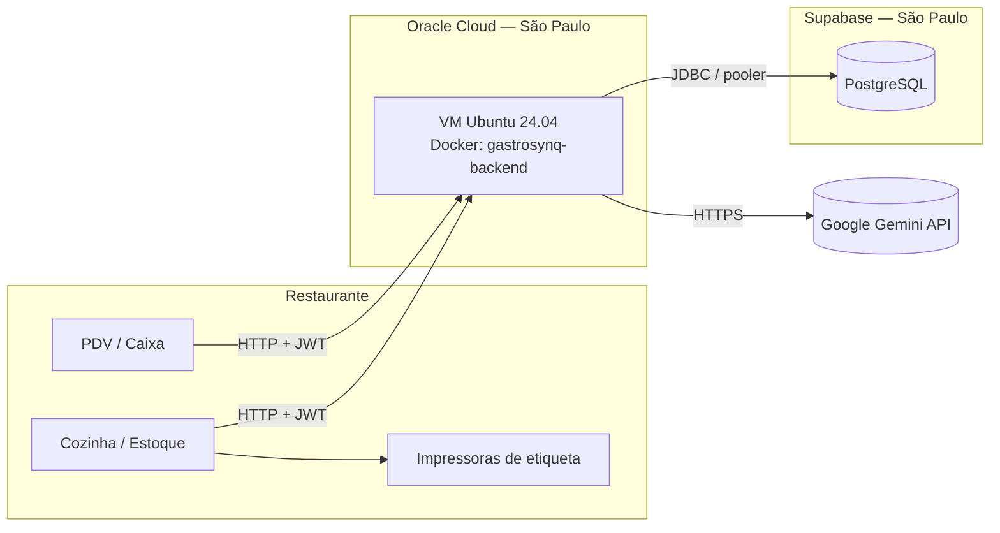

# INFRAESTRUTURA.md

# Infraestrutura e Implantação — GastroSynq

## Visão Geral

O GastroSynq roda em produção com três peças:

| Peça | Onde roda | Tecnologia |
| --- | --- | --- |
| **Cliente desktop** | Computadores do restaurante (Windows) | WinForms / .NET Framework 4.8 |
| **API backend** | VM na Oracle Cloud (região São Paulo) | Spring Boot 3 / Java 21 em Docker |
| **Banco de dados** | Supabase (região São Paulo) | PostgreSQL gerenciado |
| **IA** | Google (nuvem) | API do Gemini |



**Decisão importante:** a VM e o banco estão na **mesma região (São Paulo)**. Com o banco em outra região, cada consulta faz uma viagem de ida e volta de ~120–150 ms; na mesma região, menos de 5 ms. Ver [DESEMPENHO.md](DESEMPENHO.md).

---

# Servidor (Oracle Cloud)

| Item | Valor |
| --- | --- |
| Provedor | Oracle Cloud Infrastructure — Always Free |
| Shape | `VM.Standard.E2.1.Micro` (x86) |
| Sistema | Ubuntu 24.04 LTS |
| Memória | 1 GB RAM + 2 GB de swap |
| Região | Brazil East (São Paulo) |
| Porta exposta | 8080 (API) |

O shape Ampere A1 (ARM, mais memória) chegou a ser planejado, mas nunca teve capacidade disponível na região; o projeto foi adaptado para rodar na VM Micro de 1 GB.

## Ajustes para 1 GB de memória

* **SerialGC** no Java — coletor de lixo que usa menos memória que o padrão.
* **`MaxRAMPercentage=45`** — o Java usa no máximo 45% da RAM, deixando espaço para o sistema e evitando o swap (lento).
* **Pilha de thread reduzida** (`-Xss512k`).
* **Pool de conexões fixo em 4** (ver Banco de Dados).
* O deploy **para o backend antes de compilar**, porque Maven e aplicação juntos não cabem na memória.

---

# Docker

O backend roda em um único container, definido em `backend-api/docker-compose.yml`:

```yaml
services:
  backend:
    build:
      context: ./apiJPA
    container_name: gastrosynq-backend
    ports:
      - "8080:8080"
    env_file:
      - .env
    environment:
      JAVA_TOOL_OPTIONS: >-
        -Duser.timezone=America/Sao_Paulo
        -XX:+UseSerialGC
        -XX:MaxRAMPercentage=45
        -Xss512k
      TZ: America/Sao_Paulo
    restart: unless-stopped
    logging:
      driver: json-file
      options:
        max-size: "10m"
        max-file: "3"
```

| Configuração | Motivo |
| --- | --- |
| `TZ` e `user.timezone` = São Paulo | A VM roda em UTC; sem isso, o "dia" do chat, do caixa e dos alertas virava às 21h |
| `restart: unless-stopped` | O backend volta sozinho se a VM reiniciar ou o processo cair |
| Log limitado a 3 × 10 MB | Antes o log crescia sem limite até lotar o disco |
| `env_file: .env` | Segredos ficam fora do código e fora do Git |

---

# Deploy

A atualização do backend é feita com um único script, `backend-api/deploy.sh`:

```bash
cd ~/GastroSynq/backend-api
bash deploy.sh                 # usa a branch padrão
bash deploy.sh minha-branch    # ou outra branch
```

O script:

1. Baixa o código da branch (`git fetch`, `checkout`, `pull`).
2. Para o backend atual (libera memória para a compilação).
3. Recompila a imagem e sobe o container (`docker compose up -d --build`).
4. Remove imagens antigas.
5. Mostra as últimas linhas do log.

| Etapa | Tempo aproximado |
| --- | --- |
| Compilação (Maven dentro do Docker) | ~5 min |
| Inicialização do Spring Boot | ~60 s |

## Comandos úteis na VM

```bash
docker logs -f gastrosynq-backend                     # log ao vivo
docker logs gastrosynq-backend --tail 50              # últimas 50 linhas
docker logs gastrosynq-backend --since 5m 2>&1 \
  | grep -E "\[Tempo\]|\[Lento\]"                      # tempo de cada requisição
docker compose up -d --force-recreate                 # reiniciar relendo o .env
docker ps                                             # status do container
```

---

# Banco de Dados (Supabase)

| Item | Valor |
| --- | --- |
| Serviço | Supabase (PostgreSQL gerenciado) |
| Região | `sa-east-1` — São Paulo |
| Conexão | **Session pooler** (porta 5432, IPv4) |
| Esquema | Criado e atualizado pelo Hibernate (`ddl-auto=update`) |

A conexão direta do Supabase usa apenas IPv6, que a VM não suporta; por isso o backend usa o **session pooler**, que funciona em IPv4.

## Pool de conexões (HikariCP)

O session pooler do plano gratuito aceita **15 conexões no total**. Conexões abandonadas chegaram a ocupar todas as vagas e impedir o backend de subir. A configuração final:

| Propriedade | Valor | Motivo |
| --- | --- | --- |
| `maximum-pool-size` | 4 (`HIKARI_MAXIMUMPOOLSIZE`) | Sobra espaço para outras ferramentas e para o ambiente local |
| `minimum-idle` | igual ao máximo | Conexões sempre prontas, sem custo de abrir na hora |
| `keepalive-time` | 120 s | Mantém as conexões vivas |
| `max-lifetime` | 10 min | Renova conexões antes que o pooler as derrube |

## Migração de região

O banco foi criado inicialmente em `us-east-2` (Ohio) e migrado para São Paulo:

```bash
# 1. cópia do banco antigo (estrutura + dados do schema public)
pg_dump "$URL_ANTIGA" --schema=public --no-owner --no-privileges > backup.sql

# 2. restauração no banco novo
psql "$URL_NOVA" -f backup.sql

# 3. troca das variáveis SPRING_DATASOURCE_* no .env e recriação do container
docker compose up -d --force-recreate
```

`pg_dump` e `psql` foram executados a partir da própria VM via imagem `postgres:17-alpine`, sem instalar nada no servidor.

---

# Variáveis de Ambiente

Os segredos ficam no arquivo `backend-api/.env` (fora do Git). O repositório traz um `.env.example` com todas as variáveis documentadas.

## Obrigatórias

| Variável | Uso |
| --- | --- |
| `SPRING_DATASOURCE_URL` | URL JDBC do banco (`jdbc:postgresql://...:5432/postgres?sslmode=require`) |
| `SPRING_DATASOURCE_USERNAME` | Usuário do banco |
| `SPRING_DATASOURCE_PASSWORD` | Senha do banco |
| `GEMINI_KEY_1` ... `GEMINI_KEY_30` | Chaves da API do Gemini (pelo menos uma; usadas em rodízio) |
| `JWT_SECRET` | Frase longa e aleatória que assina os tokens de login |

## Opcionais

| Variável | Padrão | Uso |
| --- | --- | --- |
| `HIKARI_MAXIMUMPOOLSIZE` | 4 | Conexões com o banco |
| `SHOW_SQL` | false | Mostrar SQL no log (depuração) |
| `TEMPO_LENTO_MS` | 800 | A partir de quantos ms uma requisição é marcada como `[Lento]` |
| `GEMINI_MODELO` | `gemini-3.5-flash-lite` | Modelo de conversa e ferramentas |
| `GEMINI_MODELO_TTS` | `gemini-3.8-flash-lite-tts` | Modelo de voz |
| `INSIGHT_CRON` | `0 0 9-23 * * *` | Horário dos insights automáticos |
| `CAIXA_FECHAMENTO_CRON` | `0 0 5 * * *` | Fechamento automático do caixa esquecido aberto |

---

# Cliente Desktop

O endereço da API é configurado no `App.config` do projeto WinForms:

```xml
<appSettings>
  <add key="ApiBaseUrl" value="http://ENDERECO_DA_VM:8080" />
</appSettings>
```

* Para desenvolvimento local: `http://localhost:8080`.
* O timeout das requisições é de 150 s, para cobrir respostas da IA que fazem mais de uma chamada ao Gemini.
* Impressoras de etiqueta (Windows/Niimbot) são configuradas e salvas em cada computador.

---

# Ambiente de Desenvolvimento

**Backend**

1. Configurar as variáveis de ambiente obrigatórias (ver `.env.example`) na IDE ou no sistema.
2. Executar a classe `ApiJpaApplication` pela IDE, ou `mvn spring-boot:run` dentro de `backend-api/apiJPA`.

Alternativa com Docker (igual à produção):

```bash
cd backend-api
cp .env.example .env     # preencher as variáveis
docker compose up -d --build
```

**Frontend**

Abrir a solução no Visual Studio, ajustar `ApiBaseUrl` no `App.config` e executar.

---

# Monitoramento

* **`TempoRequisicaoFiltro`** registra o tempo de cada requisição no log:
  ```text
  [Tempo] GET /estoque/listar 92 ms
  [Lento] POST /agente/perguntar 3705 ms (status 200)
  ```
* Permite identificar gargalos com dados reais antes de otimizar.

---

# Primeiro Acesso

Em uma instalação nova, o banco não tem nenhum usuário. Ao abrir o sistema:

1. O cliente consulta `GET /setup/status`.
2. Se não houver usuários, abre a tela de **configuração inicial**.
3. O primeiro cadastro é criado como **gerente** (`POST /setup/inicial`).
4. O gerente cadastra os demais funcionários pelo sistema.

Não existe usuário administrador fixo no código.

---

# Pontos de Atenção

* A API é exposta por HTTP simples na porta 8080; para uso comercial, o próximo passo é colocar HTTPS (proxy reverso com certificado).
* Backups do banco dependem do Supabase; um `pg_dump` periódico agendado é uma melhoria recomendada.
* A VM de 1 GB comporta o uso de um restaurante; para mais unidades, migrar para um shape maior.